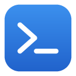

#  TermCraft

**One window for all your terminals and remote connections.** TermCraft
gives you tabbed local terminals, SSH with a built-in file browser, Telnet,
RDP, VNC, serial ports, FTP, Amazon S3, tunnels, X11 forwarding and more, on
Windows, macOS and Linux. It is free and open source.

- Save your servers as sessions and open them with a double click.
- Bring your sessions over from MobaXterm, PuTTY or `~/.ssh/config`.
- Run it from a USB stick (portable mode) or install it.
- Passwords stay in your system keychain or in a file locked with your own
  master password. TermCraft collects nothing about you.

> TermCraft is a young project. Please report problems in
> [Issues](../../issues).

## Download

Get the latest version from the [Releases](../../releases/latest) page.

| System | File | How to start |
|---|---|---|
| Windows 10 / 11 (64-bit) | `TermCraft-…-windows-x86_64-portable.zip` | Unzip anywhere and run `termcraft.exe` |
| macOS 11+ (Apple Silicon) | `TermCraft-…-macos-aarch64.app.zip` | Unzip and move **TermCraft** to *Applications* |
| macOS 11+ (Intel) | `TermCraft-…-macos-x86_64.app.zip` | Same as above |
| Linux (Debian, Ubuntu…) | `termcraft_…_amd64.deb` | `sudo apt install ./termcraft_…_amd64.deb` |
| Linux (any) | `TermCraft-…-linux-x86_64-portable.zip` | Unzip and run `./termcraft` |

See [Notes for each system](#notes-for-each-system) for first-run warnings
and the programs TermCraft can work with.

## First steps

1. Click  **Session** and pick a
   type (SSH, RDP…). Enter the host name and, if you like, the user name.
2. Click **OK**: the session is saved in the left panel and opens in a tab.
3. Next time, double-click it in the  **Sessions** list, or type `user@host` in **Quick connect**.

Click **Start local terminal** for a shell on your own computer.

Already use MobaXterm? Put TermCraft next to your portable MobaXterm (or
just start it on a computer with MobaXterm installed): at first start it
offers to bring over your sessions, settings (font, colors, terminal, SSH…)
and trusted host keys. Your `MobaXterm.ini` is only read, never changed.
You can also do it later: right-click *User sessions › Import MobaXterm
sessions* and choose a `MobaXterm.ini` or an exported `.mxtsessions` file.
Saved passwords cannot be imported (MobaXterm encrypts them); TermCraft asks
for each one the first time.

## Session types

| | Type | What it does |
|---|---|---|
|  | **SSH** | Secure shell to Linux / Unix servers and network devices. Shows the server's files beside the terminal (SSH-browser), checks the server's identity, supports keys, agents, jump hosts, proxies, X11 and agent forwarding. |
|  | **Telnet** | Old-style terminal connections, mostly for network equipment. |
|  | **Rsh** | rlogin connections to legacy Unix machines. |
|  | **Xdmcp** | A full graphical Linux / Unix desktop through an X server. |
|  | **RDP** | Windows Remote Desktop, opened in your system's remote desktop app. |
|  | **VNC** | Remote screen of any machine running a VNC server, in your VNC viewer. |
|  | **FTP** | File transfer with FTP or encrypted FTPS, side by side with your own files. |
|  | **SFTP** | Secure file transfer only: your files on the left, the server's on the right; drag files between them. |
|  | **Serial** | COM / USB serial ports for routers, switches, boards and modems. |
|  | **File** | A bookmark to a local file or folder. |
|  | **Shell** | A local terminal with the shell you choose (Bash, Zsh, PowerShell, Cmd, WSL). |
|  | **Browser** | A bookmark to a web page (http / https). |
|  | **Mosh** | Mobile shell: keeps working over bad Wi-Fi and roaming (needs Mosh installed). |
|  | **Aws S3** | Browse Amazon S3 buckets like folders; upload and download files. |
|  | **WSL** | Windows Subsystem for Linux distributions, in a tab (Windows only). |

## Everyday features

| | Feature | What it does |
|---|---|---|
|  | **SSH-browser** | Every SSH tab shows the remote folder in the sidebar and follows the terminal's `cd`. Upload by dropping files, download, rename, delete, change permissions, edit remote files and save them back. |
|  | **Split terminals** | See 2 or 4 terminals at once; detach a tab to its own window. |
|  | **MultiExec** | Type once, send to every open terminal. |
|  | **SSH tunnels** | Local, remote and dynamic (SOCKS) port forwarding, started with one click. |
|  | **Jump hosts** | Reach servers behind one or several SSH gateways — also for Telnet, RDP and VNC. |
|  | **X11 forwarding** | Graphical programs from the server open as windows on your desktop. |
|  | **Macros** | Record keystrokes once, replay them in any terminal. |
|  | **Syntax highlighting** | Colors words such as *error*, *warning*, *OK* and IP addresses in terminal output; shell, Cisco, Perl and SQL modes, or your own. |
|  | **Popup terminal** | A system-wide shortcut (Ctrl + Alt + F12) drops a terminal from the edge of the screen, over any program. |
|  | **Text editor** | Edit local or remote files with colors, find / replace and line numbers. |
|  | **Diff tool** | Compare two text files side by side. |
|  | **Image viewer** | Double-click a picture on a server to see it. |
|  | **Servers** | Share a folder over TFTP or HTTP in one click — handy for flashing network equipment. |
|  | **SSH key generator** | Create Ed25519, ECDSA or RSA keys (OpenSSH and PuTTY formats). |
|  | **Passwords** | Save passwords and named credentials in the system keychain, or in an encrypted file protected by a master password. |
|  | **Known hosts** | See and remove the servers whose identity you accepted. |
|  | **Shared sessions** | Read your team's session list from a shared folder or a web address. |
|  | **Look and feel** | Light, dim and dark skins, color saturation, transparency, compact mode, keyboard shortcuts. *View › Iconify TermCraft* hides the window in the system tray; click the tray icon to bring it back. |
|  | **Automatic updates** | TermCraft checks for new versions and installs them when you agree. Every update is signed and verified. |
|  | **Portable mode** | Put an empty file named `termcraft.portable` next to the program: all settings then stay in its folder. |

Right-click a session for more: *Connect as…*, *SFTP session*,
*Create a desktop shortcut*, *Save session to file* and others.

## Notes for each system

### Windows

- **First start:** TermCraft is not signed yet, so Windows SmartScreen may
  say "Windows protected your PC". Click *More info › Run anyway*.
- **Bash:** local terminals use Bash from
  [Git for Windows](https://git-scm.com/download/win) or MSYS2 when
  installed; otherwise PowerShell or Cmd (choose in
  *Settings › Configuration › Terminal*).
- **WSL** sessions need the Windows Subsystem for Linux.
- **X11 forwarding and Xdmcp** need an X server such as
  [VcXsrv](https://sourceforge.net/projects/vcxsrv/) or Xming, started
  before the session.
- **RDP** opens in the built-in Remote Desktop app (mstsc). **VNC** needs a
  viewer such as TigerVNC or TightVNC in your `PATH`.
- **Servers** (TFTP / HTTP): Windows Firewall asks once whether to allow
  them on your network.

### macOS

- **First start:** TermCraft is not notarized yet. Right-click
  **TermCraft** in *Applications* and choose *Open*, then *Open* again. If
  macOS says the app is damaged, run
  `xattr -dr com.apple.quarantine /Applications/TermCraft.app`.
- **X11 forwarding** uses [XQuartz](https://www.xquartz.org/); TermCraft
  starts it when needed. **Xdmcp** needs Xephyr.
- **RDP** opens in Microsoft's *Windows App* (Remote Desktop); **VNC** in the
  built-in Screen Sharing.
- **Popup terminal:** macOS may ask you to allow TermCraft under
  *System Settings › Privacy & Security* for the global shortcut to work.
- Updates replace the program inside `TermCraft.app`.

### Linux

- The `.deb` package puts `termcraft` in your applications menu. Update it
  with a newer `.deb` (the automatic updater leaves package installs to your
  package manager). The portable zip updates itself.
- **RDP** uses FreeRDP (`xfreerdp`) or Remmina; **VNC** uses TigerVNC,
  `vncviewer` or Remmina; **Xdmcp** uses Xephyr — install them from your
  distribution.
- **Tray icon:** shown on KDE, XFCE, Cinnamon and other desktops with a
  system tray; GNOME needs the *AppIndicator* extension. Without a tray,
  *Iconify* just minimizes the window.
- **Popup terminal** shortcut: works on X11. Under Wayland it depends on the
  desktop (XWayland apps only).
- **Servers** on ports below 1024 (TFTP 69, HTTP 80) need administrator
  rights; pick a higher port in the server's settings instead.

## Where your settings are

| | Location |
|---|---|
| Windows | `%APPDATA%\TermCraft` |
| macOS | `~/Library/Application Support/TermCraft` |
| Linux | `~/.config/termcraft` and `~/.local/share/termcraft` |
| Portable mode | `termcraft-data` next to the program |

Passwords are never written in these files in clear text.

## For power users

`termcraft-cli` (included) runs the same actions from scripts: list or add
sessions, open tabs, type into them, start tunnels and servers. Run
`termcraft-cli commands` to see them all. When TermCraft is open, the
commands go to its window; otherwise they change your saved sessions
directly (tabs then need the window). AI assistants can drive TermCraft
through `termcraft-cli mcp` (Model Context Protocol).

## License and credits

TermCraft is free software under the [MIT](LICENSE-MIT) or
[Apache-2.0](LICENSE-APACHE) license, at your option. Icons:
[Phosphor Icons](https://phosphoricons.com/) (MIT).

TermCraft is an independent project. It is not affiliated with, sponsored
by, or endorsed by Mobatek or MobaXterm. Product names are only used to
describe compatibility, such as importing exported session files.

Want to help? See [CONTRIBUTING.md](CONTRIBUTING.md).
